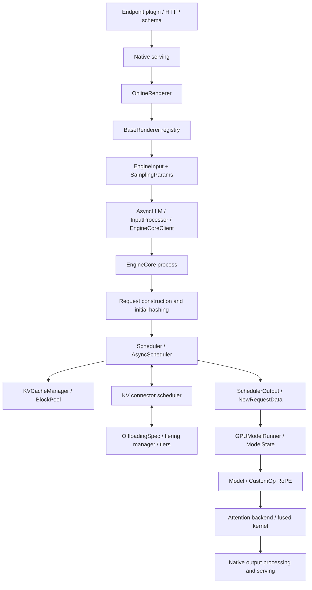

# vLLM 最小侵入接入评估

评估日期：2026-09-18。源码基线为 `upstream-base`（`08b3e67b669d18d5bbd14e456b8bb4794916e402`），评估对象为 fork `70f75ac`。以下保留实施前的源码分析；文中的“当前”指该评估快照。最新累计差异以[修改清单](vllm-patch.md)为准，执行结果见[验证记录](decoupling-validation.md)。

后续已落实元数据通道合并、部署级 Writer 加载、原生存储路径隔离、OnlineRenderer 构造接口、外置位置映射和外部 attention backend。渲染使用 BaseRenderer 组合而非覆盖全局 renderer registry，共享已有对象及其缓存；原生 InputProcessor 也已恢复。累计补丁为 22 个源码文件、`+314/-44`。attention kernel 的 RoPE 参数已替换为通用变换参数，具体配置属于 ReLoCache。以下候选清单不是待办列表。

## 结论

当前 28 个源码文件、`+410/-46` 的补丁不是已经证明的最小边界。PIC 语义移出 vLLM 与 vLLM 修改最小化是两件事：当前完成了大量职责迁移，但部分接入仍新增了已有机制可以承接的数据通道，attention 接口也仍带有具体表示参数。

建议先收回重复的元数据通道和存储命名空间修改，再缩小渲染、worker 和 attention 的接入边界。保留原生调度、页管理和搬运，不以复制它们换取 fork 的零差异。

- **优先收回**：部署级 Writer tensors 的逐请求传输、独立 worker metadata 字段、`FileMapper.key_encoding`。改用部署配置、原生插件参数和原生存储路径配置。
- **进一步收窄**：渲染回调、ModelState 选择、attention backend 到 kernel 的调用接口。现有 registry 有帮助，但并不覆盖所有构造点。
- **需性能证据后决定**：把 position mapping 移到 ReLoCache 自有 GPU kernel。可减少三个原生文件的修改，代价是每步多一次 kernel launch。
- **仍有实际引擎需求**：首次 hash 前的 Request 构造、缓存准入等待与请求级失败、不能重算的缓存加载、按请求追踪持久化、跨 DP 查询结果，以及共享物理 KV 下的逻辑 attention。

不承诺一个尚未实现的最终文件数。减少参数和字段、减少生命周期耦合、恢复整个文件，是不同层次的收益，下面分别说明。

## 原生执行路径与扩展点

这条路径跨 API、EngineCore 和 worker 进程。前端插件对象或 Python 子类存在于某个进程，不代表它会自动穿过 IPC 或替换另一个进程中的构造对象。

| 原生机制 | 能承接的工作 | 不能据此推断的能力 |
| --- | --- | --- |
| [endpoint/general plugins](../third_party/vllm/vllm/plugins/endpoint_plugins/interface.py) | HTTP 路由与应用状态；各进程加载引擎侧注册代码。 | Endpoint plugin 不提供 Scheduler/ModelRunner 的任意方法覆盖。 |
| [RendererRegistry](../third_party/vllm/vllm/renderers/registry.py) | 选择 `BaseRenderer` 实现，扩展 tokenization/chat rendering。 | 它不选择 `OnlineRenderer`；Responses item 转换发生在调用 BaseRenderer 之前。 |
| [SamplingParams.extra_args](../third_party/vllm/vllm/sampling_params.py) | 原生明确允许插件附加参数；随请求送到 scheduler 和 worker。 | 任意 Python 对象和 Tensor 不会因此自动获得正确的 IPC 解码。 |
| `scheduler_cls` | 选择同步或异步 Scheduler 子类，复用原生调度主循环。 | 基线在 `EngineCore` 构造 Request；`add_request` 已晚于初始 hash。 |
| [worker_cls / worker_extension_cls](../third_party/vllm/vllm/v1/worker/worker_base.py) | 选择 worker 类；extension 添加新方法供 RPC 使用。 | `worker_extension_cls` 明确拒绝与已有属性冲突，不能用来覆盖 `load_model` 或执行主循环。 |
| [model.get_model_state_cls](../third_party/vllm/vllm/v1/worker/gpu/model_states/__init__.py) | 模型自行选择 ModelState。 | 对跨模型的执行扩展没有独立配置入口；当前 `model_state_cls` 配置是 fork 新增的。 |
| [CustomOp registry](../third_party/vllm/vllm/model_executor/custom_op.py) | 在模型保持原生结构时替换 RoPE 实现。 | 不负责重写 KV 页的逻辑寻址或 attention mask。当前 RoPE 已使用该机制。 |
| [Attention backend registry](../third_party/vllm/vllm/v1/attention/backends/registry.py) | 注册外部 backend、metadata builder 和 attention implementation。 | 不自动给原生 fused kernel 注入循环内的 PIC 运算。 |
| KV connector module、[OffloadingSpecFactory](../third_party/vllm/vllm/v1/kv_offload/factory.py)、secondary tier factory | 外部 connector/spec/tier 实现与配置。 | 原生 connector 仍直接构造 scheduler，原生 tiering spec 仍直接构造 manager；嵌套组件不能全靠注册外层自动替换。 |

IO processor 的输出接口面向 pooling，不能当作这里生成服务的通用替代。`collective_rpc` 经 executor 到 worker，也不能替代 scheduler 所在进程的控制接口。

## 逐层评估

### 1. 请求元数据：优先消除第二套传输通道

当前路径是 `EngineInput.extension → EngineCoreRequest.extension → Request.extension`，再以 `NewRequestData.worker_metadata` 传布局。这些字段来自 fork。

原生 `SamplingParams.extra_args` 已允许插件参数，`NewRequestData` 也已携带 `sampling_params`。因此内容描述、引用区间、操作 ID 和 worker 布局可以使用一个命名空间，例如 `extra_args["relocache"]`，无需再为布局新增第二个 worker 字段。

但不能只把当前 `RequestExtension` 整体塞进去：[`MsgpackDecoder.dec_hook`](../third_party/vllm/vllm/v1/serial_utils.py) 依赖目标类型识别 Tensor；`dict[str, Any]` 中的嵌套 tensor 没有等价的 typed decoding 保证。当前 typed tensor 字段有实际作用，移除它的前提是消除相应传输需求。

这个前提在当前部署语义下可以满足：

1. Writer Pre/Post soft tokens 已固定在 `additional_config.relocache.writer_soft_tokens`。每个 EngineCore 启动时加载一次，用部署 Writer 构造显式/自动编译输入；引用请求只携带不可变源 tokens、身份和区间。
2. Reader embeddings 和显式 Writer 混合 embeddings 继续使用原生 `prompt_embeds` 与 `prompt_is_token_ids`。自动 Writer 在 EngineCore 内构造，不需要 API→EngineCore 的另一份 soft-token tensor。
3. Scheduler 完成布局后，在输出请求的 sampling parameters 中放入纯值布局；复制将被修改的字典，避免污染其他请求或被重复调度的 payload。worker 从相同插件命名空间读取。

需要落实的入口是 **渲染结果到 SamplingParams 的连接**。现有 renderer 回调返回 EngineInput，而 native serving 在之后创建 SamplingParams；不能声称换个字段就能无条件恢复 `input_processor.py`。优先在 ReLoCache 的请求/serving 接入中完成这一步；如果这会迫使复制原生 serving 主流程，保留一个小的输入元数据合并接口更合理。原生 HTTP `vllm_xargs` 只支持受限值类型，不应把内部嵌套布局伪装成这个用户字段。

可明确争取恢复 `engine/__init__.py` 和 `core/sched/output.py`；`input_processor.py` 是否整个恢复取决于入口实现。`request.py` 可删除 extension 传递，但内部请求、必需缓存量等仍被 native 路径使用，不会随之自动恢复。

源码依据：[transport.py](../src/relocache/backends/vllm/transport.py)、[部署配置](../src/relocache/backends/vllm/config.py)、[ContentService](../src/relocache/backends/vllm/content.py)、[InputProcessor.process_inputs](../third_party/vllm/vllm/v1/engine/input_processor.py)、[NewRequestData](../third_party/vllm/vllm/v1/core/sched/output.py)。

### 2. 前端渲染：复用不同层的接口，保留原生解析尾部

当前三类 callback 加在 OnlineRenderer，Responses 转换另改了 utils。它们并非都必须保持当前形态。

- **Completion**：自有 OnlineRenderer 子类覆盖 `preprocess_completion` 即可识别结构化 blocks；保留原生 `render_completion` 的校验和调用流程。普通输入调用 `super()`，无需保留当前 completion callback。
- **Chat**：主要计算发生在 `BaseRenderer.render_chat_async`，可通过 registry 注册适配 renderer。原生 `OnlineRenderer.preprocess_chat` 继续构建 template/tokenization 参数，并执行后面的 tool/reasoning `adjust_request`。不要把整个 preprocess 方法搬到 ReLoCache。
- **Responses**：输入先经过 `construct_input_messages`，assistant parts 可能先被转换；只注册 BaseRenderer 太晚。保留 item 转换的小接口，或把消息转换提取为 OnlineRenderer 可覆盖方法。不能通过复制 `render_responses` 的历史、工具和 Harmony 处理来消掉这一处 diff。

另一个实际边界是构造：[`init_app_state`](../third_party/vllm/vllm/entrypoints/launchers/api_server/app_state.py) 直接创建 OnlineRenderer，随后把同一对象传给 serving/tokenization，最后才调用 endpoint plugin 的 `init_state`。替换 `state.online_renderer` 一个属性不会更新这些已有引用。

因此，推荐先使用原生 BaseRenderer registry 收回 Chat 回调；要采用自有 OnlineRenderer，则增加一个明确的构造入口，或由插件在初始化阶段完整装配自身服务对象。不要用实例方法 monkeypatch、`__class__` 变更或逐请求更换共享 renderer。一个构造入口可能使修改换到另一个文件，但比三个持续扩散的算法回调更容易维护。

源码依据：[OnlineRenderer](../third_party/vllm/vllm/renderers/online_renderer.py)、[BaseRenderer](../third_party/vllm/vllm/renderers/base.py)、[Responses 转换](../third_party/vllm/vllm/entrypoints/openai/responses/utils.py)、[当前 endpoint 接入](../src/relocache/backends/vllm/api.py)。

### 3. Scheduler：保留时间点正确的窄接口

PIC 在调度器中做的事情不是实现另一套分配器，而是把独立可复用页和 Dynamic Content 排成原生能够查找和分配的存储序列。这仍需几个准确的执行位置。

| 接入点 | 为什么已有接口不足 | 建议 |
| --- | --- | --- |
| Request 构造 | `Request.__init__` 已调用 `update_block_hashes`；Scheduler.add_request 发生在之后。 | 保留 `create_request` factory，让 PICRequest 在初次 hash 前建立语义。 |
| 本地命中后的准入 | 需要原生实际命中结果来触发/等待 Writer，然后继续 native connector lookup。 | 保留小的 defer/admission 接口；不要覆盖整段 waiting 队列调度。 |
| 必需缓存缺失 | PIC 的占位输入不能作为普通 token 重算；已完成的加载也不能误判成编译 miss。 | 保留必需缓存准入和请求级错误通道。 |
| 内部 Writer | EngineCore 自动创建的 Writer 没有对应 API collector，但仍须走正常执行、释放和持久化。 | 保留内部请求的输出策略，内容编译状态由 ReLoCache 管理。 |
| 排列与输出打包 | 当前使用 `_get_local_prefix_cache_hit`、`_update_after_schedule`、`_free_request`。 | 不再增加同义 hook；后续上游化聚焦已实际使用的边界，而非建立 scheduler framework。 |

当前 adapter 使用了 native protected 方法，并访问 `KVCacheManager.coordinator`、`block_pool`。因此“fork 没有 ReLoCache import”不等于“没有内部耦合”。需要在升级时关注这些调用点；不应为隐藏耦合再包一层原样转发的 API。

把所有等待都塞进 connector 也不合适：connector 的 `(matched_tokens, async_load)` 表达搬运状态；Writer 创建、读者依赖和错误归属仍在 scheduler。让 connector 反向操纵 scheduler 或复制它的队列策略，会增加双向耦合。

源码依据：[Request](../third_party/vllm/vllm/v1/request.py)、[EngineCore](../third_party/vllm/vllm/v1/engine/core.py)、[Scheduler](../third_party/vllm/vllm/v1/core/sched/scheduler.py)、[PIC scheduler](../src/relocache/backends/vllm/scheduler.py)、[缓存排列](../src/relocache/backends/vllm/cache.py)。

### 4. Worker：区分 ModelState 注入与 position mapping 的融合

原生 ModelState 已有请求加入/移除、staged writes、attention metadata 和模型输入准备等生命周期，适合作为 PIC worker 的接入层。当前 adapter 继承 DefaultModelState，无须换整个 ModelRunner。

`model.get_model_state_cls()` 是原生入口；若只支持一个自有模型，可以直接由模型提供。但为所有现有 decoder 模型注册包装类，或借 model loader 动态给模型安装方法，会把执行策略耦合到模型定义/权重加载。当前跨模型接入保留显式 `model_state_cls` 选择比这些绕路更合理。原生 worker extension 也不能覆盖已有 load 方法。

position mapping 有两种可比较的实现：

| 方案 | 原生修改 | 运行代价与边界 |
| --- | --- | --- |
| 当前融合到 `prepare_pos_seq_lens` | input_batch、model_runner、ModelState interface 共三个文件。 | 在原生准备位置的同一个 kernel 写逻辑位置，不增加 launch。 |
| 在自有 ModelState 准备阶段映射 | 可恢复上述三个文件；保留 ModelState 选择。 | 根据 batch 的 request index、query offsets 和 storage positions 写入固定 GPU buffer；每步增加一个小 kernel。 |

第二种在调用顺序上可行：原生先准备 storage positions 并计算 slot mapping，然后调用 `model_state.prepare_attn`，再调用 `model_state.prepare_inputs`；后者返回的 `positions` 会覆盖模型输入默认值。逻辑位置可在自有 metadata/input 准备阶段生成，slot mapping 继续使用原生 storage positions。注意 metadata、图捕获和模型调用应共享稳定地址的逻辑位置 buffer。

这证明了存在替代接入位置，没有证明额外 launch 的性能可接受。应比较 batch=1 decode、批量 decode 和 chunked prefill 的步延迟；若开销明显，保留当前融合扩展，而不是为了三个文件牺牲执行效率。

源码依据：[GPUModelRunner.prepare_inputs / prepare_attn / execute_model](../third_party/vllm/vllm/v1/worker/gpu/model_runner.py)、[位置准备 kernel](../third_party/vllm/vllm/v1/worker/gpu/input_batch.py)、[PICModelStateAdapter](../src/relocache/backends/vllm/worker.py)。

### 5. Attention：最大的改动是执行能力，不能靠 connector 取代

attention 两个文件占新增行的 `144/410`，约 35%。核心差异是：同一物理 KV 页可出现在多个逻辑位置；mask 和 key rotation 必须按每次引用的逻辑位置计算，而非按 block table 顺序计算。原生 KV connector 只解决 KV 所有权交接和搬运，无法表达这些循环内运算。

现有 attention backend registry 允许外置 PIC backend，能够把 PIC metadata、builder 和参数装配放在 ReLoCache。当前 `triton_attn.py` 中的 `logical_ranges`、RoPE frequencies、style/scaling 等仍是具体表示参数，不能只因 callback 名字通用就称作完成了通用化。

但外置 backend 不等于原生 kernel 无须修改：`TritonAttentionImpl.forward` 直接调用模块函数 `unified_attention`，该函数再进入 fused Triton kernel。继承 backend 不能自动覆盖这个调用。要复用原生 forward 和 kernel，有两个真实选择：

1. **推荐**：在原生 backend 保留一个小的执行函数选择/参数传递接口，PIC metadata 和组装属于外部 backend；kernel 内保留必要的 traversal、mapping、key transform 能力。仍复用原生 tiling、KV load、softmax、split reduction。
2. **自有完整 PIC kernel**：通过原生 backend registry 接入，不改原生 attention kernel。但由 ReLoCache 独立维护性能、图执行和各 kernel 路径。这是更大的 kernel 所有权决策，不能把复制一份 upstream kernel 视作解耦完成。

当前优先选择第一种。评估接口时要写清楚：storage length 与 logical extent 各自控制什么，callback 在 causal/window mask 和 split reduction 的哪个阶段执行，普通 attention 如何保留原来的 specialization。仅把若干参数装进 `Any` 容器不会减少算法耦合。

也不采用“先把每次引用的 KV 展开并旋转，再调用原生 attention”的方案：它把复用收益换成额外 KV materialization、显存和搬运，与当前服务目标冲突。

源码依据：[TritonAttentionImpl.forward](../third_party/vllm/vllm/v1/attention/backends/triton_attn.py)、[unified_attention](../third_party/vllm/vllm/v1/attention/ops/triton_unified_attention.py)、[ReLoCache fused callbacks](../src/relocache/kernels/attention.py)。

### 6. Offload：复用原生状态机，收回表示策略，保留加载语义

**可以移出 `FileMapper` 的是表示命名空间。** 原生 filesystem tier 接受 `root_dir`，object tier 接受 `prefix`。ReLoCache 在配置边界为它们加上表示目录/前缀，即可隔离普通 RoPE KV 和 pre-RoPE KV，恢复 `file_mapper.py`。需同时处理用户原生配置中已有的 fs/obj tiers，而不只是便捷参数 `kv_dir`。不能直接删除字段却仍共享同一个持久化命名空间；仅给 Writer 页更换 hash 也不能覆盖普通 Dynamic Content 页。

**不能直接删除的是 mandatory load 的区别。** 原生 `TieringOffloadingManager.lookup` 在 secondary HIT、CPU promotion 分配失败时可返回 MISS，因为普通输入允许重算。PIC 必须在这个明确分支返回 RETRY；真正缺失仍为 MISS。不能在外层把全部 MISS 改成 RETRY，也不能重新遍历私有 jobs 猜测原因。

原生 `ReqContext` 已有 `set_state/get_state`，可承接适配器附加状态，不必为所有统计都新增全局字段。不过原生 manager 若需要基于“缓存是否必需”作决定，仍需要明确的策略输入；把字段搬到 state 并不会消除这一执行能力。

**持久化完成与统计是另外两项能力：**

- `compile(persist=true)` 等待该 Writer 的 GPU→CPU 和 secondary writes，不阻塞其他请求。原生全局 `has_pending_work()` 不能替代按请求查询。
- 原生 TieringMetricsTracker 已记录 job 生命周期并输出聚合统计，可作为收敛观测接口的基础；但聚合指标不能直接替代目前返回给请求的各级 load jobs/pages/seconds。

如果要把这些策略/观测移入外部 offload 组件，首先需要小的 scheduler/manager 构造入口或生命周期 observer。当前 [`OffloadingConnector`](../third_party/vllm/vllm/distributed/kv_transfer/kv_connector/v1/offloading_connector.py) 和 [`TieringOffloadingSpec.get_manager`](../third_party/vllm/vllm/v1/kv_offload/tiering/spec.py) 直接创建具体类。不要先初始化原生对象再替换其内部 manager，也不要复制 spec 中的共享内存创建、握手和清理来绕过构造点。

现阶段保留 mandatory load、公开工作查询和请求观测的窄补丁，比再实现一套 connector 更合理。当前 `storage.py` 已用原生 per-tier lookup 检查驻留，无需另加查询框架。

共享 mmap 的 unlink 是独立资源生命周期修复，涉及 shared_offload_region 和 tiering/spec；应独立说明和上游化，但拆成单独提交不会减少 `upstream-base → HEAD` 的总差异。不能为了减文件数撤销已发现的资源问题。

源码依据：[ReqContext](../third_party/vllm/vllm/v1/kv_offload/base.py)、[tiering manager](../third_party/vllm/vllm/v1/kv_offload/tiering/manager.py)、[filesystem 配置](../third_party/vllm/vllm/v1/kv_offload/tiering/fs/manager.py)、[object 配置](../third_party/vllm/vllm/v1/kv_offload/tiering/obj/manager.py)、[当前存储查询](../src/relocache/backends/vllm/storage.py)。

### 7. 控制面与生成输出：与 PIC 数学实现分开判断

`EngineCore.scheduler_call` 使内容状态、编译状态和 flush 使用现有 utility RPC 到达 scheduler。现有 `collective_rpc` 到 worker，不能替换它。原生 client 工厂直接选择 AsyncMPClient/DP client，实现自有 client 子类还需要构造入口；为删除几行 dispatcher 建立另一条 socket/RPC 通道没有收益。

`all_results` 解决的是 native DP utility 聚合后只返回第一个结果的问题。聚合含义应继续由服务决定，不在 native client 按 PIC 方法名分支。`wait_for_requests_to_drain` 只轮询 engine-running 状态，且不同 client 的实现不同，不是按请求持久化查询的替代。

错误与 stream metadata 共修改六个 serving/protocol 文件。这些是跨生成 API 的输出传播：

- scheduler 的请求错误需要保留 stop reason，普通 native error handling 继续使用。
- Completion/Chat 最后一个 usage chunk 需要携带已有的 KV 元数据，非流式和流式才能给出一致统计。

若保留当前服务契约，这些小补丁合理。把整条 SSE 生成搬到 ReLoCache，或解析后重写 native SSE，只是把少量公开输出扩展变成更重的私有依赖。不能静默删掉这部分统计来宣称 PIC 已实现零侵入。

## 28 个文件的处理清单

路径均相对 fork 根目录。这里的“收回”是后续实施目标，不表示本文已改动。

| 文件 | 处理方向 |
| --- | --- |
| `vllm/renderers/online_renderer.py` | 收窄。Chat 使用 BaseRenderer registry；Completion 使用 preprocessing override；Responses 留消息转换边界。OnlineRenderer 注入需明确构造入口。 |
| `vllm/entrypoints/openai/responses/utils.py` | 可替换当前 callback 形态，但不能丢掉结构化 assistant item；不复制 Responses 主流程。 |
| `vllm/entrypoints/generate/base/serving.py` | 保留通用请求错误原因传播。 |
| `vllm/entrypoints/openai/chat_completion/protocol.py` | 保留流式 KV 元数据字段。 |
| `vllm/entrypoints/openai/chat_completion/serving.py` | 保留错误和最后 usage chunk 的元数据传播。 |
| `vllm/entrypoints/openai/completion/protocol.py` | 保留流式 KV 元数据字段。 |
| `vllm/entrypoints/openai/completion/serving.py` | 保留错误和最后 usage chunk 的元数据传播。 |
| `vllm/entrypoints/openai/responses/serving.py` | 保留请求错误原因传播。 |
| `vllm/v1/engine/__init__.py` | 优先恢复。纯值插件参数与原生 embeddings 取代 RequestExtension。 |
| `vllm/v1/engine/input_processor.py` | 争取恢复；取决于渲染结果如何进入 SamplingParams，必要时保留小的合并接口。 |
| `vllm/v1/request.py` | 删除 extension 链路；保留 native 执行实际需要的内部请求/缓存要求等状态。 |
| `vllm/v1/core/sched/output.py` | 优先恢复。通过已有 sampling_params 传 worker 布局。 |
| `vllm/v1/core/sched/interface.py` | 保留初次 hash 前的 Request factory。 |
| `vllm/v1/core/sched/scheduler.py` | 保留准入、请求错误、内部执行的窄能力；协调策略留在子类。 |
| `vllm/v1/engine/core.py` | 保留 Request factory 调用和 scheduler utility dispatch。 |
| `vllm/v1/engine/core_client.py` | 保留显式获取所有 DP 结果的能力。 |
| `vllm/v1/worker/gpu/model_states/__init__.py` | 当前保留独立 ModelState 选择，避免修改每个模型或更换 runner。 |
| `vllm/v1/worker/gpu/model_states/interface.py` | 若外置映射 kernel 性能可接受，恢复。 |
| `vllm/v1/worker/gpu/model_runner.py` | 同上，删除额外位置映射调用。 |
| `vllm/v1/worker/gpu/input_batch.py` | 同上，恢复原生位置准备 kernel。 |
| `vllm/v1/attention/backends/triton_attn.py` | 将 PIC metadata 和参数装配外置，保留小的 kernel 调用扩展；不复制 forward。 |
| `vllm/v1/attention/ops/triton_unified_attention.py` | 当前保留 fused 执行能力，收紧 callback contract；完整外置 kernel 是另一项架构投入。 |
| `vllm/distributed/kv_transfer/kv_connector/v1/offloading/scheduler.py` | 保留页序同步、按请求工作查询；统计可朝既有生命周期接口收敛。 |
| `vllm/v1/kv_offload/base.py` | 附加状态优先复用 ReqContext state；必需加载策略与工作查询仍需明确接口。 |
| `vllm/v1/kv_offload/tiering/manager.py` | 保留容量等待与真实 miss 的区别；保留按请求完成/观测能力。 |
| `vllm/v1/kv_offload/file_mapper.py` | 优先恢复。ReLoCache 配置 fs root / obj prefix 负责表示隔离。 |
| `vllm/v1/kv_offload/cpu/shared_offload_region.py` | 独立生命周期修复，保留。 |
| `vllm/v1/kv_offload/tiering/spec.py` | 独立生命周期修复，保留。 |

## 实施顺序与验收

1. **元数据与存储路径**：先移除每请求 Writer tensors，合并 metadata 通道，隔离原生 fs/obj 路径。目标是首先恢复 engine request schema、scheduler output schema、FileMapper 三个文件；输入处理入口单独判定。检查显式/自动 Writer 身份一致、Reader embeddings、重复引用、DP 与重启加载。不要为移除少数字段新增整套 serving wrapper。
2. **渲染边界**：先收回可由 BaseRenderer 承接的 Chat 回调，再明确 OnlineRenderer 构造与 Responses item 转换接口。检查普通/结构化 Completion、Chat、Responses，特别是 assistant parts、tool/reasoning 参数尾处理、stream 与取消。
3. **worker position mapping**：做一个使用原生 ModelState 生命周期的外置实现，与当前融合实现比较真实 decode/prefill 步延迟；根据结果决定是否恢复三个 worker 文件。对照 logits、重复引用、分块和 CUDA graph。
4. **attention 与 offload 接口**：将特定 metadata/策略移到外部组件，保留融合算法和原生状态机的最小执行接口。检查逻辑 mask、split reduction、容量受限 RETRY、真缺失、驱逐重载和并发持久化。

已有验证记录继续有效，见[拆分验证](decoupling-validation.md)。这些候选实现尚未执行；实现到对应步骤才补做受到改变影响的验证。新增测试和说明均放在主仓库，临时实施安排不写入 AGENTS.md。EPIC、CacheBlend 等重算方法和压缩方法仍按既有 roadmap 暂缓，不因本次收缩永久删除未来支持方向。
